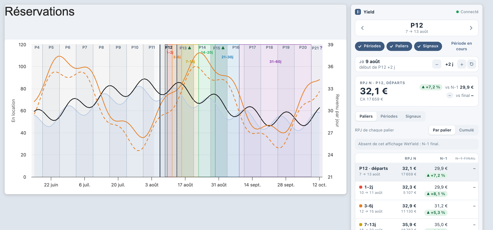
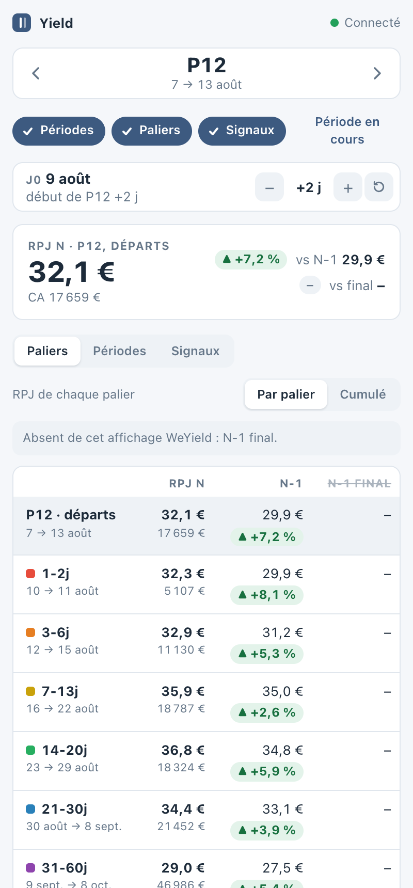
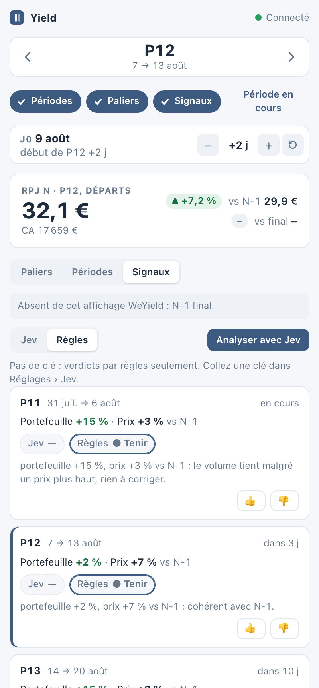
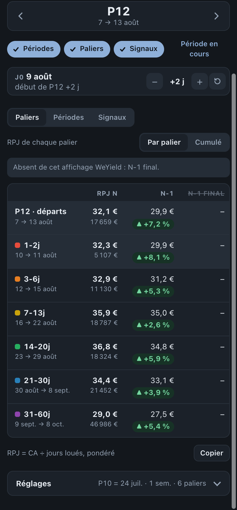
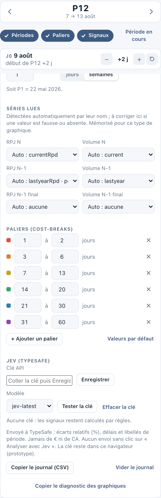
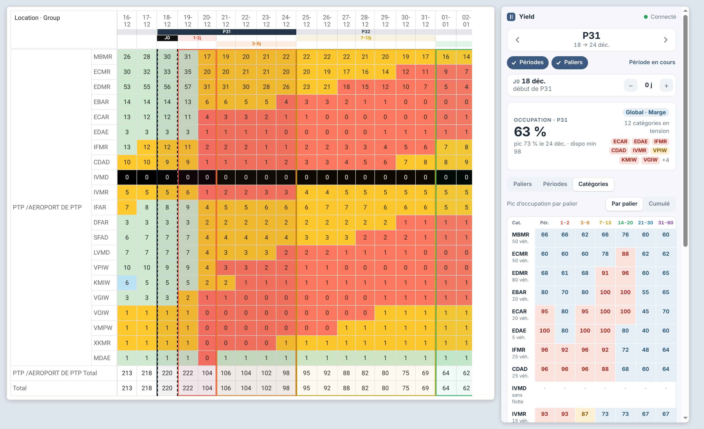

# Yield WeYield – panneau latéral (v3.5.1)

*Chrome side-panel extension for [WeYield](https://www.weyield.io) revenue-management users: overlays pricing periods and cost-break zones on the booking charts, compares ADR (RPJ) with last year / last year final, and flags over- or under-pricing with simple rules and an optional TypeSafe "Jev" check. Unofficial, not affiliated with WeYield or TypeSafe. Documentation below in French.*

Extension Chrome pour le point yield sur `apps.weyield.io` → **Réservations**, et sur la **Balance de flotte de Rentway** (`rentwayv1.emotionmobility.com`). Le graphique ou le tableau garde toute sa place : l'extension y dessine les périodes (P10, P11…) et les paliers (cost-breaks), et **tout le reste vit dans le panneau latéral de Chrome** (RPJ N, N-1, N-1 final sur WeYield ; occupation et catégories en tension sur Rentway ; réglages).

Chrome 114 ou plus récent.



*Le graphique garde toute sa largeur ; périodes (P11, P12…), paliers (1-2j, 3-6j…) et signaux (▲ P13, ▲ P15, ? P21) y sont dessinés, et tout le reste vit dans le panneau latéral de Chrome. Captures réalisées sur une maquette à données synthétiques.*

<table>
<tr>
<td width="33%"><br><sub><b>Paliers</b> : RPJ N, N-1 et N-1 final par palier, avec le décalage de J0.</sub></td>
<td width="33%"><br><sub><b>Signaux</b> : verdict prix × volume par période, règles à côté de Jev, 👍 / 👎.</sub></td>
<td width="33%"><br><sub><b>Thème sombre</b> automatique.</sub></td>
</tr>
</table>

<details>
<summary>Réglages (découpage en périodes, séries lues, paliers, clé Jev)</summary>



</details>

## Installation / mise à jour
1. `chrome://extensions` → activer le **mode développeur**.
2. Première fois : **Charger l'extension non empaquetée** → choisir ce dossier. Mise à jour : icône ↻ sur la carte de l'extension, puis recharger l'onglet WeYield.
3. Épingler l'extension, puis **cliquer sur son icône** : le panneau s'ouvre à droite (et se referme).

Le panneau suit l'onglet actif. S'il affiche « Page non connectée », rechargez l'onglet WeYield.

## Utilisation
- **Période de travail** (en haut du panneau) : `‹ P12 ›` ou les flèches ← → du clavier. Un **clic sur le graphique** sélectionne aussi la période cliquée (un glisser pour zoomer ne change rien). « Période en cours » revient à celle qui contient la date de référence.
- **Calques** Périodes / Paliers : indépendants, activables ensemble.
- **J0 et décalage** : J0 = premier jour de la période choisie + le décalage (− / + en jours, ↺ pour remettre à 0). Les paliers se calculent depuis J0 : un palier « a-b j » couvre J0+a → J0+b. La ligne « départs » de la période n'est jamais décalée.
- **Synthèse** : RPJ N de la période avec Δ vs N-1 et vs N-1 final.
- **Tableau** : *Paliers de Pk* (départs + un palier par ligne) ou *Toutes les périodes* (clic ou Entrée sur une ligne = la choisir). **Survoler une ligne la fait ressortir sur le graphique.** Chaque colonne N-1 / N-1 final donne la valeur et l'écart. **Copier** exporte en TSV (Excel / Sheets).
- **Paliers : Par palier | Cumulé** (bascule au-dessus du tableau, mémorisée). *Par palier* : RPJ des seuls jours du palier. *Cumulé* : chaque palier va du premier palier jusqu'à lui inclus (21-30j = J0+1 → J0+30), pour N, N-1 et N-1 final. Raison : le RPJ d'une date mêle toutes les locations en cours ce jour-là ; la zone 21-30j de P13 contient aussi les départs de P14 en 14-20j, de P15 en 7-13j, etc. Le survol fait ressortir tous les paliers additionnés ; la copie suit la vue (libellés « cumulé »).
- **Réglages** (repliés, résumé en un coup d'œil) : « Période n° 10 commence le 24/07/2026 », durée d'une période, liste des paliers (un champ par palier, couleur identique au graphique, corrigés si incohérents). Tout s'applique immédiatement, **sur WeYield et sur Rentway** : périodes et paliers se règlent une seule fois.
- **Même période sur les deux sites** (Réglages › WeYield ↔ Rentway, cochée par défaut) : choisir P13 sur WeYield affiche aussi P13 sur Rentway, et inversement, avec le même décalage de J0. Les onglets ouverts suivent en direct, panneau ouvert ou non. Une page ouverte plus tard reprend la période choisie si elle date de moins de 12 h, sinon la période en cours. Décochée : chaque site garde sa période (les paliers et les périodes restent communs).
- Thème clair / sombre automatique.

## Balance de flotte Rentway
Même panneau, mêmes périodes et mêmes paliers, posés sur le tableau de la Balance de flotte (vision micro des disponibilités) :



*P31 choisie (J0 = 18 déc.) : la période et les paliers 1-2j, 3-6j, 7-13j… sont dessinés sous les dates et encadrés dans le tableau ; le panneau donne l'occupation de la période, les catégories en tension et, onglet Catégories, le pic d'occupation de chaque catégorie par palier. Capture réalisée sur une maquette à données synthétiques (flottes et disponibilités fictives).*

- **Dans le tableau** : sous les dates, une rangée de périodes (la période choisie en foncé) et deux rangées de paliers ; dans les valeurs, séparateurs de périodes, cadres de couleur des paliers et colonne J0 en pointillé. Le calque suit le défilement, se redessine après chaque recherche et **laisse passer les clics** (un clic sur une valeur ouvre toujours le détail Rentway). Un **clic sur une date de l'en-tête** choisit la période.
- **Synthèse** : occupation de la période (1 − dispo ÷ flotte, jours additionnés, toutes catégories affichées), jour le plus chargé, dispo minimale, et les **catégories en tension** (jour le plus chargé ≥ seuil « limite », ou dispo négative).
- **Paliers / Périodes** : occupation moyenne, pic, dispo minimale et son jour, nombre de catégories en tension. **Cumulé** = du premier palier à la fin de celui-ci : le goulot que traverse une location de cette durée.
- **Catégories** (remplace l'onglet Signaux) : matrice catégorie × (période, paliers) du **pic d'occupation** en %, coloré par niveau ; en surbooking, la cellule affiche la dispo négative. Survol d'une cellule = la zone ressort dans le tableau.
- **Seuils d'occupation** (Réglages) : 81 / 86 / 87 % par défaut (confortable, limite, pic, formation yield du 16/04/2026), modifiables.
- **Réglages communs** : découpage en périodes et paliers enregistrés une fois dans l'extension et appliqués aux deux sites ; à la première installation, ils sont repris de WeYield (jamais des valeurs par défaut d'une page Rentway encore vierge). Les seuils d'occupation restent propres à Rentway.
- Pas de prix ni de N-1 dans la balance : ni RPJ, ni signaux, ni Jev côté Rentway.

Structure observée sur le vrai Rentway et méthode de dessin : [docs/rentway-layout.md](docs/rentway-layout.md).

## Signaux prix × volume (onglet « Signaux »)
Pour chaque période à venir, le panneau croise le **volume** (N vs N-1) et le **prix** (RPJ N vs N-1, avec N-1 final en contexte) et rend un verdict : **▲ Relever · ▼ Baisser · ● Tenir · ? Voir**. Le filtre affiché sur la page WeYield fait foi (une catégorie à la fois). Le volume se lit différemment selon la page, et les cartes l'indiquent :
- **Page Réservations → « Portefeuille »** : OnRent déjà acquis vs N-1 à la même date.
- **Page Évolution des réservations → « Rythme »** : réservations nettes captées sur la fenêtre affichée (7 / 14 / 21 / 28 jours) vs N-1, et prix des réservations captées.

**Règles** (gratuites, instantanées) : toujours calculées ; seuils dans `src/signals.js` (`T`), hypothèses de départ à recalibrer avec le journal.

**Jev** (TypeSafe System One), bouton « Analyser avec Jev » :
- Le **code décide seul** ce qu'il sait décider : une période aux données partielles ou au volume faible est tranchée « Voir » sans appeler Jev (carte « Jev n/a »).
- Pour les autres, **une requête par période, 5 questions rapides en parallèle** : deux lectures (volume, prix) pour contrôle, deux oui/non (« prix trop bas ? », « prix trop haut ? ») et un choix direct Tenir / Relever / Baisser.
- Le **verdict est composé des deux oui/non** : trop bas ≥ 60 % et trop haut < 40 % → Relever ; l'inverse → Baisser ; les deux < 40 % → Tenir ; sinon « Voir » (contradictoire ou hésitant). Le choix direct est gardé à côté pour comparer.
- Les champs inconnus sont **omis** de la requête (jamais « not available » : Jev y lit « données manquantes » et répond « Voir » partout, ce qui arrivait sur l'onglet En portefeuille, sans N-1 final). Questions et clés d'état en anglais, langue d'entraînement de Jev.
- **« Détail Jev »** sur chaque carte : probabilités brutes (trop bas / trop haut, choix direct) et « Copier la requête et la réponse brutes » pour diagnostiquer un verdict surprenant.
- Un résultat devient « périmé » (grisé, barré) dès que les chiffres de la période changent.

**Graphique** : seules les exceptions s'affichent (« Tenir » = silence) : la période se teinte (opacité = confiance) et son étiquette reçoit le pictogramme (« P13 ? »). Bascule Jev / Règles dans l'onglet.

**👍 / 👎** sur chaque carte (👎 propose la bonne réponse) : journal local + score « Jev x/y · Règles z/w » (+ Jev choix direct) sur les verdicts étiquetés. C'est l'expérience qui dira si Jev apporte quelque chose par rapport aux règles. Réglages › Jev › « Copier le journal (CSV) ».

**Clé API** : à coller dans Réglages › Jev (stockée dans `chrome.storage.local`, jamais dans la page WeYield). Utilisez une clé dédiée à plafond de dépense. **Rien n'est envoyé sans clé ni sans clic sur « Analyser avec Jev »**, et seulement des écarts relatifs (%), des délais et des libellés de période : jamais de € ni de CA.

## Séries lues (Réglages › Séries lues)
Les dispositions de WeYield ont été **observées sur le vrai site le 20/10/2026** (détail : [docs/weyield-layout.md](docs/weyield-layout.md)). Rôles résolus automatiquement :

| Route | Graphique lu | Volume N | Volume N-1 | Volume N-1 final | RPJ N | RPJ N-1 | RPJ N-1 final | Nature |
| --- | --- | --- | --- | --- | --- | --- | --- | --- |
| `bookings/lastyear` (En portefeuille) | l'unique | `current` | `lastyear` | – | `currentRpd` | `lastyearRpd` | – | Portefeuille |
| `bookings/final` (Final) | l'unique | `current` | – | `lastyearFinal` | `currentRpd` | – | `lastyearFinalRpd` | Portefeuille |
| `new-bookings/1-day`, `7-days`, `30-days` | le second | `thisyear` | `lastyear` | – | `revenue` | `ly_revenue` | – | Rythme · N j |

Les séries anonymes (« Series N »), les flottes et les `delta` ne sont jamais des rôles ; une série sans point (`lastyear` sur Final) compte comme absente. Les libellés d'info-bulle (« OnRent net », « Revenu par jour ») ne sont pas des noms de séries. Le panneau affiche ce qui a été retenu pour chacun des 6 rôles ; une liste déroulante corrige un rôle (mémorisé par disposition de graphique). **Une série ne peut pas servir deux rôles** : un réglage en conflit est ignoré et signalé (« Réglage ignoré »). Le choix manuel d'un graphique n'est honoré que sur ce graphique.

- **Fenêtre du rythme** : sur `new-bookings/*`, la fenêtre « N derniers jours » (boutons radio) est lue et affichée (« Rythme · 7 j »), transmise à Jev, et un changement de fenêtre périme les résultats Jev.
- **Menu « Avancé »** (`bookings/*`) : tant que le mode **RevCar** n'a pas été observé, l'extension n'affiche aucun RPJ dans ce mode (note dédiée) ; repasser sur « Revenu par jour ».
- **Valeurs non finies** : les NaN et ±Infinity des jours sans volume net (`new-bookings/1-day`) sont ignorés ; sur le rythme, un volume net total ≤ 0 donne la moyenne simple des RPJ finis.
- **Libellés sur `new-bookings/*`** : décalés de 16 px pour ne pas recouvrir les « ? » de WeYield (valeur à confirmer à l'œil).

## Lecture des chiffres
- RPJ = CA ÷ jours loués, moyenne pondérée par le nombre de voitures en location (`OnRent` × `Revenu par jour`, comme l'infobulle WeYield).
- Cumulé : même formule sur toute la plage du premier palier à la fin du palier (CA cumulé ÷ jours loués cumulés), pas une moyenne simple des RPJ des paliers. Les jours entre deux paliers non contigus comptent (une location plus longue les traverse).
- N-1 = série `lastyear` (même date) ; N-1 final = série `lastyearFinal`. Si l'affichage WeYield n'en charge qu'une, l'autre colonne est barrée et un message l'indique.
- Seuls les jours chargés dans le graphique comptent : `⚠ 4/7 j chargés` signale une zone coupée.

## Architecture
```
manifest.json         MV3 : side_panel, service worker, content scripts WeYield et Rentway
src/core.js           logique pure : dates, paliers, grille de périodes, RPJ, occupation de flotte, export
src/chart.js          WeYield : graphiques Highcharts (détection, lecture des séries, dessin)   ┐
src/pivot.js          Rentway : PivotGrid DevExtreme de la balance de flotte (lecture, calques)  │ monde MAIN
src/engine.js         état, calcul, dessin, réception des actions — voit le site via WY.src     ┘ (dans la page)
src/signals.js        signaux : caractéristiques, règles, requête et décodage Jev, journal (pur)
src/relay.js          pont chrome.runtime ↔ page (monde isolé, liste blanche) ; réglages communs WeYield / Rentway (chrome.storage)
src/background.js     clic sur l'icône → ouvre le panneau
src/panel/            panel.html / .css / .js : vue + actions, aucun calcul métier
test/*.test.js        tests unitaires        →  npm test   (dont fleet.test.js : balance de flotte ; shared.test.js : réglages communs)
test/browser/         bancs navigateur       →  cd test/browser && npm install && npm test   (WeYield)
                                                                          puis npm run test:rentway   (Rentway)
                                         captures du README  →  npm run screenshots   /   npm run screenshots:rentway
```
Le panneau ne touche pas à la page : il reçoit des instantanés du moteur et lui renvoie des actions validées (clés autorisées, bornes). L'état est conservé dans le `localStorage` de la page (clé `wyYield3`) ; les réglages des versions précédentes sont repris au premier lancement. Les réglages communs aux deux sites (périodes, paliers, période synchronisée) vivent dans `chrome.storage.local` (clé `wypShared`) : le relais de chaque onglet les applique au chargement et à chaque changement, et y enregistre ceux faits sur sa page.

Le banc Rentway charge l'extension réelle sur une maquette de la Balance de flotte (même structure DOM et même accès Vue / DevExtreme que le vrai Rentway, données synthétiques) et vérifie 48 points : réglages communs repris de WeYield, période synchronisée dans les deux sens (option décochée, reprise sous 12 h), alignement des calques sur des colonnes de largeurs variables, chiffres recoupés par un calcul indépendant, matrice des catégories, survol, clic sur une valeur sous le calque, clic sur une date, défilement, nouvelle recherche, seuils, copie, diagnostic, réglage renvoyé vers WeYield, thème sombre, 320 px, page sans tableau.

Le banc WeYield charge l'extension réelle sur une maquette WeYield (vrai Highcharts, séries nommées comme dans WeYield), ouvre le panneau sur cet onglet et vérifie 114 points (avec une fausse API TypeSafe aux formats documentés) : montage, navigation, décalage, survol, clic/zoom, chiffres recoupés par un calcul indépendant, réglages, copie, reconnexion après rechargement, graphique recréé, états sans page, migration, thème sombre, 320 px.

## Autres versions (sauvegardes dans `prototypes/`)
- `weyield-extension.v2.0.0-drawer.bak/` : barre au-dessus du graphique + tiroir en dessous (sans décalage de J0).
- `weyield-extension.v1.2.1.bak/` : version d'origine.

**N'activez qu'une version à la fois** dans `chrome://extensions` : elles dessinent toutes sur le même graphique.

## Limites connues
- **Rentway** : observé sur une configuration (station Aéroport, vue Groupes, 02/12/2026 → 31/05/2027). Vues par zone / pays, par segments, et plusieurs stations à la fois : lues (chiffres additionnés, note dans le panneau) mais pas encore vérifiées sur le vrai site. Pas de date de référence dans la balance : « Période en cours » = aujourd'hui.
- **Jev jamais appelé pour de vrai** par l'auteur de ces tests : la chaîne est testée avec une fausse API aux formats de la documentation (noul / choice / score). Commencez par « Tester la clé » ; si une erreur « Réponse Jev inattendue » ou 422 apparaît, c'est un écart de format à corriger.
- Seuls `bookings/lastyear`, `bookings/final` et `new-bookings/{1,7,30}-days` ont été observés ; les autres routes (Évolution, Estimé, Transactions, Air Analytics…) peuvent donner des lectures vides ou fausses. Le mode RevCar, les fenêtres autres que celle par défaut et le sens des RPJ négatifs ne sont pas observés (voir la fin de `docs/weyield-layout.md`).
- Les N-1 sont alignés par WeYield à 364 jours (même jour de semaine) : Pâques, carnaval, Route du Rhum… faussent la comparaison. Pas de calendrier d'événements pour l'instant.
- Les seuils des signaux (`T` dans `src/signals.js`) ont été fixés pour des volumes de portefeuille ; sur une fenêtre de 1 jour les volumes nets sont minuscules et les pourcentages varient beaucoup : à recalibrer avec le journal 👍/👎.
- Fermer le panneau ne retire pas l'overlay du graphique : il reste tel que configuré.

## Confidentialité
L'extension ne contacte aucun serveur de son propre chef. Elle lit les graphiques de la page `apps.weyield.io` et le tableau de la Balance de flotte Rentway ouverts dans votre navigateur (aucun appel aux API Rentway) et garde ses réglages localement (`localStorage` de la page, `chrome.storage.local` de l'extension). Seul l'appel optionnel « Analyser avec Jev » sort vers `api.typesafe.ai`, avec votre propre clé et uniquement des écarts relatifs (jamais de montants). Aucune télémétrie.

## Licence
MIT, voir [LICENSE](LICENSE). « WeYield », « Rentway » et « Jev / TypeSafe » appartiennent à leurs propriétaires ; ce projet n'est ni affilié à eux ni approuvé par eux.
